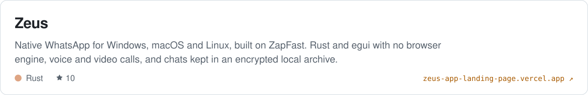
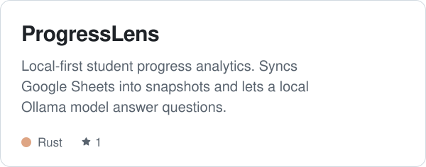
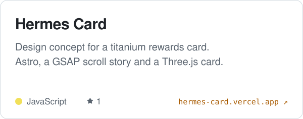
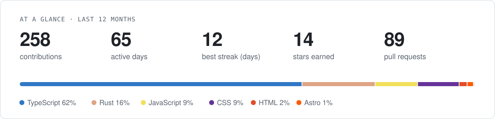

<picture>
  <source media="(prefers-color-scheme: dark)" srcset="https://raw.githubusercontent.com/ItIsNotKeshav/ItIsNotKeshav/output/header-dark.svg">
  
</picture>

- Building **[Zeus](https://github.com/ItIsNotKeshav/Zeus)**, a native WhatsApp desktop client written in Rust, with voice and video calls.
- Made **[ProgressLens](https://github.com/ItIsNotKeshav/ProgressLens)**, a desktop app that tracks student progress with an AI model that runs entirely on your machine.
- At home across the stack: React and Next.js on the front, Supabase and SQLite underneath, Rust and Tauri on the desktop.

### Featured

  <a href="https://github.com/ItIsNotKeshav/Zeus"><picture>
    <source media="(prefers-color-scheme: dark)" srcset="https://raw.githubusercontent.com/ItIsNotKeshav/ItIsNotKeshav/output/project-zeus-dark.svg">
    
  </picture></a>
  <a href="https://github.com/ItIsNotKeshav/ProgressLens"><picture>
    <source media="(prefers-color-scheme: dark)" srcset="https://raw.githubusercontent.com/ItIsNotKeshav/ItIsNotKeshav/output/project-progresslens-dark.svg">
    
  </picture></a>
  <a href="https://github.com/ItIsNotKeshav/cardsite"><picture>
    <source media="(prefers-color-scheme: dark)" srcset="https://raw.githubusercontent.com/ItIsNotKeshav/ItIsNotKeshav/output/project-cardsite-dark.svg">
    
  </picture></a>

### Toolbox

<picture>
  <source media="(prefers-color-scheme: dark)" srcset="https://skillicons.dev/icons?i=rust%2Cts%2Creact%2Cnextjs%2Ctauri%2Ctailwind%2Cnodejs%2Csupabase%2Csqlite%2Castro%2Cthreejs%2Cvercel%2Cpython%2Cjava&theme=dark&perline=14">
  
</picture>

### Activity

<picture>
  <source media="(prefers-color-scheme: dark)" srcset="https://raw.githubusercontent.com/ItIsNotKeshav/ItIsNotKeshav/output/overview-dark.svg">
  
</picture>

<picture>
  <source media="(prefers-color-scheme: dark)" srcset="https://raw.githubusercontent.com/ItIsNotKeshav/ItIsNotKeshav/output/snake-dark.svg">
  
</picture>

The cards above are drawn by <a href="scripts/cards.mjs">a small script</a> and refreshed daily by a GitHub Action.
